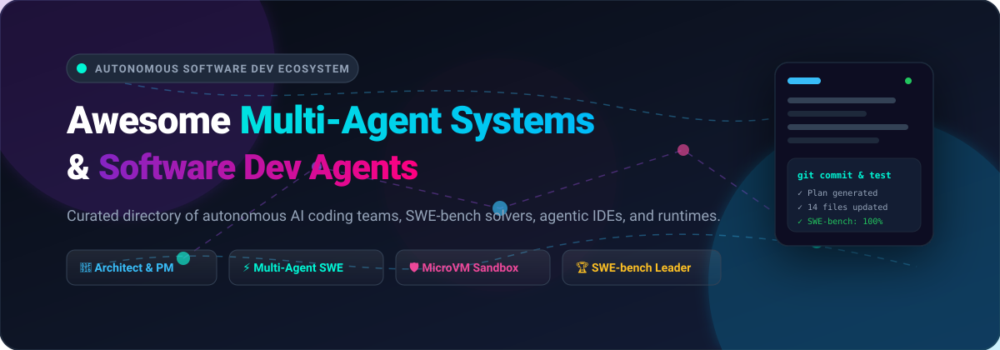

<p align="center">
  
</p>

<p align="center">
  <a href="https://github.com/ishandutta2007/Awesome-Awesome-Awesome"></a><a href="https://discord.gg/jc4xtF58Ve"></a>
  <a href="https://github.com/ishandutta2007/Awesome-Multi-Agent-Systems-Software-Dev-Agents/stargazers"></a>
  <a href="https://github.com/ishandutta2007/Awesome-Multi-Agent-Systems-Software-Dev-Agents/network/members"></a>
  <a href="https://github.com/ishandutta2007/Awesome-Multi-Agent-Systems-Software-Dev-Agents/issues"></a>
  <a href="https://github.com/ishandutta2007/Awesome-Multi-Agent-Systems-Software-Dev-Agents/blob/main/LICENSE"></a>
  <a href="https://github.com/ishandutta2007"></a>
</p>

---

# 🤖 Awesome Multi-Agent Systems & Software Dev Agents

> **A curated, comprehensive directory of Autonomous AI Software Engineers, Multi-Agent SDLC Teams, Agentic IDEs, SWE-bench Solvers, Terminal Coding Agents, and Sandboxed Execution Runtimes.**

Welcome to the definitive guide to the **Multi-Agent Systems & Software Dev Agents Ecosystem** 🚀. Modern agentic software engineering has evolved far beyond single prompt-completion code autocomplete. Today, multi-agent frameworks coordinate specialized personas (Product Manager, Software Architect, Autonomous Software Engineer, Code Reviewer, QA Tester, and DevSecOps) across sandboxed microVMs and repository trees to execute multi-file refactoring, fix complex bugs from GitHub issues, and ship verified production pull requests.

Whether you are building custom autonomous agents with **CrewAI**, **AutoGen**, or **LangGraph**, leveraging state-of-the-art SWE-bench autonomous coders like **OpenHands**, **SWE-agent**, **Cline**, or **Aider**, or deploying enterprise hosted platforms like **Devin**, **Factory**, **Augment Code**, **Windsurf**, or **GitHub Copilot Workspace**, this repository tracks the leading tools, benchmarks, and architectures.

---

## 📑 Table of Contents
- [📊 Sector Overview & Market Dynamics](#-sector-overview--market-dynamics)
- [🏢 SaaS & Hosted Platforms](#-saas--hosted-platforms)
- [💻 Open-Source GitHub Projects](#-open-source-github-projects)
- [🏗️ Architectural Categories & Taxonomy](#️-architectural-categories--taxonomy)
- [🤝 How to Contribute](#-how-to-contribute)
- [💖 Support & Sponsorship](#-support--sponsorship)
- [📈 Star History](#-star-history)
- [⚠️ Disclaimer](#️-disclaimer)

---

## 📊 Sector Overview & Market Dynamics

The AI developer tools and autonomous software engineering agent sector is estimated at **$6.2 Billion in 2024**, projected to expand beyond **$32.5 Billion by 2030** at an accelerating CAGR of **31.8%**, driven by rapid enterprise adoption of autonomous coding agents, SWE-bench verified benchmark systems, and multi-agent software engineering lifecycles.

The market exhibits **moderate fragmentation with strong bifurcated consolidation dynamics**: hyperscalers and frontier developer ecosystems (Microsoft/GitHub Copilot, Replit, Cursor) dominate developer desktop IDE real estate, while a vibrant, fiercely competitive frontier of specialized agentic scaleups (Cognition/Devin, Factory, Magic.dev, Augment, Codeium/Windsurf) and open-source ecosystems (OpenHands, MetaGPT, Cline, Aider) capture specialized multi-file workflows, autonomous repository migration, and self-hosted privacy deployments.

---

## 🏢 SaaS & Hosted Platforms

The following hosted platforms provide full-stack autonomous software engineering agents, managed cloud sandboxes, and enterprise codebase indexing. Sorted descending by company valuation / scale.

| Platform / Tool | Description | Starting Pricing | Free Tier / Free Trial Limits | Valuation / Scale |
| :--- | :--- | :--- | :--- | :--- |
| **[GitHub Copilot Workspace](https://github.com/features/copilot)** 🐙 | Cloud-integrated autonomous coding agent and collaborative workspace that turns issues into tested pull requests with spec generation and background dev sessions. | $10/user/month (Copilot Individual); $19/user/month (Business) | 30-day free trial (includes full Copilot code completion and workspace access) | **$7.5B+ (GitHub est. unit valuation within $3.1T Microsoft)** |
| **[Cursor](https://cursor.com)** ⚡ | Frontier AI-native code editor and cloud background agent orchestrating multi-file edits, repository index search, terminal execution, and parallel agent tasks. | $20/month (Pro tier) | Free forever plan with 2,000 completions + 50 slow premium requests/month (plus 14-day Pro trial) | **$2.5B Valuation** |
| **[Devin (Cognition AI)](https://cognition.ai)** 🧠 | The pioneering fully autonomous cloud AI software engineer equipped with sandboxed shell, code editor, browser, and end-to-end task resolution. | $500/month (Team plan starting tier) | No free tier; 14-day enterprise pilot / trial upon team onboarding | **$2.0B Valuation** |
| **[Replit Agent](https://replit.com)** 🎈 | Autonomous software creation agent that designs architectures, configures databases, provisions environments, and builds full-stack applications in the cloud. | $25/month (Replit Core with monthly Agent checkpoint quotas) | Free forever account includes basic IDE + 3 public repls (Agent features require Core or $0.25/checkpoint credits) | **$3.0B Valuation** |
| **[Magic.dev](https://magic.dev)** 🔮 | Frontier software engineering AI research lab developing ultra-long context reasoning models (LTM-2-mini with 100M token context) for repository-scale synthesis. | Private Beta / Enterprise contract tier pricing | Invite-only evaluation trial upon waitlist approval | **$1.5B Valuation** |
| **[Codeium / Windsurf Cascade](https://windsurf.com)** 🏄 | Collaborative agentic IDE combining deep codebase reasoning, multi-file refactoring, flow state suggestions, and terminal command execution. | $15/month (Windsurf Pro tier) | Free forever plan with unlimited autocomplete + 25 prompt/agent flows/month | **$1.25B Valuation** |
| **[Augment Code](https://augmentcode.com)** 🔍 | Enterprise-grade AI developer platform built for massive, complex monorepos with codebase context engines and autonomous coding agents. | $30/user/month (Augment Developer tier) | 14-day free trial with full codebase indexing and unlimited completions | **$977M Valuation** |
| **[Poolside](https://poolside.ai)** 🏊 | Foundation AI model developer specifically optimizing code intelligence using reinforcement learning from execution feedback for enterprise engineering teams. | Enterprise contract pricing (licensed API & private instances) | Private enterprise pilot trial upon request | **$3.0B Valuation** |
| **[Factory (Factory Code / Droids)](https://factory.ai)** 🏭 | Agent-native enterprise platform deploying specialized autonomous Droids for automated pull request reviews, migrations, testing, and issue resolution. | $20/user/month (Standard Droid Seat) | 14-day free trial with 50 autonomous droid runs | **$150M Valuation** |
| **[All Hands Cloud](https://all-hands.dev)** 🌐 | Managed enterprise cloud hosting, distributed agent fleets, and collaboration platform built atop the open-source OpenHands runtime. | $20/user/month (Cloud Team Starter) | Free tier includes $10 free compute credits (~50 automated task iterations) | **$50M Valuation (Series A)** |

---

## 💻 Open-Source GitHub Projects

Explore the premier open-source multi-agent software engineering frameworks, terminal coding tools, and sandbox execution environments. **Sorted descending by GitHub Stars count.**

| Repository & Link | Stars Badge | Key Capabilities & Architecture | Primary Tech |
| :--- | :--- | :--- | :--- |
| **[anomalyco/opencode](https://github.com/anomalyco/opencode)** | [](https://github.com/anomalyco/opencode/stargazers) | Open-source terminal-native autonomous coding agent designed for fast multi-session workflows, full LSP diagnostics, and local/cloud provider-agnostic model routing. | Go / TypeScript |
| **[OpenHands/OpenHands](https://github.com/OpenHands/OpenHands)** | [](https://github.com/OpenHands/OpenHands/stargazers) | Flagship open-source autonomous AI software developer (formerly OpenDevin) featuring Docker isolation, multi-agent delegators, browser interaction, and state-of-the-art SWE-bench benchmark scores. | Python / Docker |
| **[cline/cline](https://github.com/cline/cline)** | [](https://github.com/cline/cline/stargazers) | Autonomous VS Code extension coding agent capable of editing multi-file trees, running shell commands, opening browsers, and executing external tool protocols via MCP. | TypeScript / VS Code |
| **[FoundationAgents/MetaGPT](https://github.com/FoundationAgents/MetaGPT)** | [](https://github.com/FoundationAgents/MetaGPT/stargazers) | The pioneering multi-agent software company framework assigning Product Manager, Architect, Project Manager, and Engineer roles to synthesize PRDs, architectures, and full codebases from a single prompt. | Python |
| **[microsoft/autogen](https://github.com/microsoft/autogen)** | [](https://github.com/microsoft/autogen/stargazers) | Multi-agent conversation and orchestration framework for creating customizable, cooperating autonomous agents with Docker execution environments and Human-in-the-Loop workflows. | Python |
| **[crewAIInc/crewAI](https://github.com/crewAIInc/crewAI)** | [](https://github.com/crewAIInc/crewAI/stargazers) | Role-playing, autonomous multi-agent orchestration framework enabling collaborative agent crews (Engineers, QA Analysts, Tech Writers) to coordinate deterministic and reactive coding tasks. | Python |
| **[aaif-goose/goose](https://github.com/aaif-goose/goose)** | [](https://github.com/aaif-goose/goose/stargazers) | Open-source, extensible on-machine AI developer agent created by Block that goes beyond suggestions to write, execute, debug, and test code via Model Context Protocol (MCP) tool extensions. | Rust / Python |
| **[Aider-AI/aider](https://github.com/Aider-AI/aider)** | [](https://github.com/Aider-AI/aider/stargazers) | Renowned terminal-based AI pair programming tool supporting git-native multi-file repo-maps, automated commit authoring, linting verification, and benchmark-leading code edit formats. | Python / Git |
| **[langchain-ai/langgraph](https://github.com/langchain-ai/langgraph)** | [](https://github.com/langchain-ai/langgraph/stargazers) | Resilient cyclic graph orchestration library designed for stateful multi-agent systems, human-in-the-loop validation, checkpointing, and complex software bug repair loops. | Python / TypeScript |
| **[continuedev/continue](https://github.com/continuedev/continue)** | [](https://github.com/continuedev/continue/stargazers) | Leading open-source AI code assistant for VS Code and JetBrains enabling custom inline autocomplete, agentic codebase chat, and local LLM integrations (Ollama, vLLM). | TypeScript |
| **[OpenBMB/ChatDev](https://github.com/OpenBMB/ChatDev)** | [](https://github.com/OpenBMB/ChatDev/stargazers) | Virtual software development company framework where simulated CEO, CTO, Programmer, and Reviewer personas communicate over chat chains to design, develop, and test software. | Python |
| **[TabbyML/tabby](https://github.com/TabbyML/tabby)** | [](https://github.com/TabbyML/tabby/stargazers) | Self-hosted, enterprise-ready AI coding assistant providing high-speed autocomplete, repository context indexing, and complete data privacy without cloud lock-in. | Rust / TypeScript |
| **[Pythagora-io/gpt-pilot](https://github.com/Pythagora-io/gpt-pilot)** | [](https://github.com/Pythagora-io/gpt-pilot/stargazers) | Interactive AI developer tool that interviews engineers to clarify requirements, generates architectural specs, writes code step-by-step, and fixes errors in tight feedback loops. | Python / JavaScript |
| **[yamadashy/repomix](https://github.com/yamadashy/repomix)** | [](https://github.com/yamadashy/repomix/stargazers) | Powerful repository packing utility that transforms entire codebase directory structures and files into a single structured, token-efficient format tailored for LLM reasoning. | TypeScript |
| **[tree-sitter/tree-sitter](https://github.com/tree-sitter/tree-sitter)** | [](https://github.com/tree-sitter/tree-sitter/stargazers) | Incremental parsing system generating fast, syntax-aware concrete syntax trees (CST) used by leading coding agents for precision AST symbol extraction and multi-file semantic mapping. | C / Rust |
| **[RooCodeInc/Roo-Code](https://github.com/RooCodeInc/Roo-Code)** | [](https://github.com/RooCodeInc/Roo-Code/stargazers) | Autonomous VS Code coding assistant featuring custom persona modes (Architect, Code, Ask, Debug, Orchestrator), configurable tool permissions, and MCP integrations. | TypeScript / VS Code |
| **[SWE-agent/SWE-agent](https://github.com/SWE-agent/SWE-agent)** | [](https://github.com/SWE-agent/SWE-agent/stargazers) | Princeton NLP research agent that resolves real GitHub issues using an Agent-Computer Interface (ACI) designed specifically for code search, viewing, and patch execution. | Python |
| **[The-PR-Agent/pr-agent](https://github.com/The-PR-Agent/pr-agent)** | [](https://github.com/The-PR-Agent/pr-agent/stargazers) | Open-source autonomous PR reviewer and assistant providing automated pull request feedback, code walkthroughs, security vulnerability checks, and inline test generation. | Python |
| **[plandex-ai/plandex](https://github.com/plandex-ai/plandex)** | [](https://github.com/plandex-ai/plandex/stargazers) | Terminal AI coding engine architected for large, multi-file software engineering tasks with versioned branch sandboxes, step-by-step diff reviews, and rollback controls. | Go |
| **[e2b-dev/E2B](https://github.com/e2b-dev/E2B)** | [](https://github.com/e2b-dev/E2B/stargazers) | Secure Firecracker microVM sandboxing runtime for autonomous AI agents, enabling safe code execution, package installation, shell commands, and desktop testing. | TypeScript / Python |
| **[SWE-bench/SWE-bench](https://github.com/SWE-bench/SWE-bench)** | [](https://github.com/SWE-bench/SWE-bench/stargazers) | The gold-standard benchmark evaluation harness assessing language models and autonomous agents on resolving real-world, multi-file software engineering GitHub issues. | Python |
| **[ag2ai/ag2](https://github.com/ag2ai/ag2)** | [](https://github.com/ag2ai/ag2/stargazers) | Next-generation AgentOS (formerly AutoGen community branch) advancing multi-agent conversation systems, distributed agent scheduling, and code generation runtimes. | Python |

---

## 🏗️ Architectural Categories & Taxonomy

Autonomous software engineering agents can be categorized across four foundational architectural paradigms:

```
┌────────────────────────────────────────────────────────────────────────┐
│                   Multi-Agent Software Engineering                     │
├──────────────────┬───────────────────┬────────────────┬────────────────┤
│ 1. SDLC Teams    │ 2. Pair Agents    │ 3. Benchmarks  │ 4. Execution   │
│ (MetaGPT,        │ (Aider, Cline,    │ (SWE-bench,    │ Sandboxes      │
│  ChatDev,        │  Roo-Code,        │  SWE-gym,      │ (E2B, Docker,  │
│  CrewAI)         │  OpenCode)        │  SWE-smith)    │  Firecracker)  │
└──────────────────┴───────────────────┴────────────────┴────────────────┘
```

1. **🏢 Multi-Agent SDLC Frameworks**: Systems that simulate a digital software development agency. Agents assume distinct roles (Product Manager drafts specifications, Architect designs schemas, Engineer implements functions, QA reviews and runs tests).
2. **💻 Terminal & IDE Autonomous Pair Programmers**: Interactive agents embedded directly inside developer environments that parse repository context maps, perform file edits, run terminal test commands, and author git commits.
3. **🏆 SWE-bench Evaluators & Gyms**: Standardized environments and test harnesses measuring an agent's capability to read an issue description, locate relevant files, implement a patch, and pass hidden unit test suites.
4. **🛡️ Sandboxed Code Execution Environments**: Hardened execution sandboxes (e.g., Firecracker microVMs, gVisor, Docker containers) allowing agents to run arbitrary bash commands, install compilers, and execute test suites securely.

---

## 🤝 How to Contribute

We actively welcome contributions from the community! To suggest a new tool, benchmark, or framework:

1. **Fork** this repository 🍴.
2. **Create a branch**: `git checkout -b feature/add-new-agent`.
3. **Add entry** to `README.md` following the table schema:
   - Tool Name and Link
   - Accurate starting pricing and verified free tier limits (for SaaS)
   - Verified GitHub Stars badge (for open-source)
   - Concise 1–2 sentence capability summary
4. **Commit & Push**: `git commit -m "Add [Tool Name]" && git push origin feature/add-new-agent`.
5. **Open a Pull Request** with relevant context and documentation links.

---

## 💖 Support & Sponsorship

If this curated guide helps your engineering workflow, powers your agent research, or saves you time selecting software development tools:

- ⭐ **Star this repository** to support our open-source research and help others discover it!
- 🍴 **Fork the project** and share it with your team, engineering colleagues, or community.
- ☕ **Sponsor the Maintainer**: Support ongoing curation and open-source contributions via the **[GitHub Sponsors Dashboard](https://github.com/sponsors/ishandutta2007)**!

---

## 📈 Star History

[](https://www.star-history.com/#ishandutta2007/Awesome-Multi-Agent-Systems-Software-Dev-Agents&type=date&legend=top-left)

---

## ⚠️ Disclaimer

- This directory is a **community-curated index** provided for educational and research purposes.
- Autonomous software engineering agents possess capabilities to execute arbitrary shell scripts, modify project source code, install external packages, and create git commits. Always execute untrusted or experimental agents inside isolated, ephemeral execution sandboxes (e.g., Docker, E2B microVMs) with least-privilege token permissions.
- Always perform human code review on AI-generated pull requests before merging into production environments.
